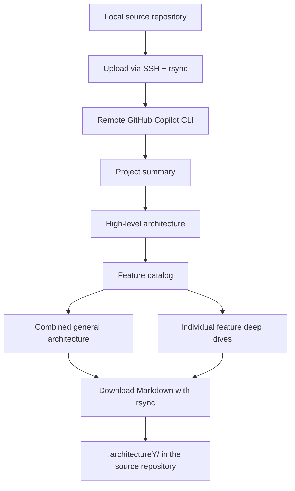

# Codebase-Manifest

**Feature-first architecture documentation for AI coding agents.**

Codebase-Manifest is an AI-powered codebase documentation generator that turns a software repository into a **consistent set of Markdown architecture and feature documents**. Instead of producing one enormous source-code dump, it asks an agent to identify the system's major capabilities, trace their execution paths to real files and functions, and describe how features depend on each other.

The goal is straightforward: give developers and coding agents a predictable place to **understand the system before changing it**.

> **Project status — early-stage.** The current Python CLI generates documentation from scratch using GitHub Copilot CLI on a remote machine. Stable, change-aware *partial updates* are a design goal, **not a feature of the current release**.

## Why Codebase-Manifest?

Coding agents can read source code, but understanding a large repository repeatedly is expensive and error-prone. A file tree tells you where code lives; it rarely tells you which business workflow owns it, what happens on the success path, or which other features it affects.

Codebase-Manifest organizes that knowledge around **business features and verified code paths**:

- **Consistent reading order.** Start with a project summary, move through the architecture and feature catalog, then open an individual feature.
- **Feature-first explanations.** Group related handlers, services, repositories, and integrations by the capability they implement—not just by directory.
- **Source-backed flow maps.** Describe concrete ingress points and the relevant repository-relative paths and function names.
- **Cross-feature context.** Record direct dependencies, events, and side effects alongside each feature.
- **Repository-native Markdown.** Read, review, diff, and version generated documents with the code they describe.

The generation prompts demand code-backed claims and standardized sections. As with any LLM-generated documentation, their accuracy must still be reviewed against the source.

## What it generates

By default, the CLI writes a `.architectureY/` directory **inside the target repository**:

```text
your-repository/
└── .architectureY/
    ├── PROJECT_SUMMARY.md
    ├── HIGH_LEVEL_ARCHITECTURE.md
    ├── FEATURE_CATALOG.md
    ├── 01_GENERAL_ARCHITECTURE.md
    ├── 01_<Feature_Key>.md
    ├── 02_<Feature_Key>.md
    └── ...
```

| Document | Purpose |
| --- | --- |
| `PROJECT_SUMMARY.md` | Concise project purpose and verified major technologies. |
| `HIGH_LEVEL_ARCHITECTURE.md` | Topology, architectural boundaries, dependency wiring, and entry points. |
| `FEATURE_CATALOG.md` | A frozen **per-run** list of major business features, their dominant roots, and merged boundaries. |
| `01_GENERAL_ARCHITECTURE.md` | The three overview documents concatenated into one reading entry point. |
| `NN_<Feature_Key>.md` | One detailed document per discovered feature, named from its catalog position and feature key. |

Each **feature detail** follows the same prescribed outline:

1. Overview and primary source files
2. Numbered execution flows with file paths and symbols
3. Cross-feature coupling: inbound/outbound dependencies, side effects, and events
4. Database schema, relevant models, and relationships (when evidenced)

**Important:** Feature numbers and keys are derived anew on each run; they are not yet persistent identities across revisions. The generated files are Markdown, not a queryable index or a live agent integration.

## How it works



The Python orchestrator runs three standalone prompts sequentially: project summary, high-level architecture, and feature catalog. It then combines their outputs and, unless disabled, runs a separate prompt for each feature found in the catalog.

Copilot CLI executes on a configured remote VM so it can inspect the uploaded code and write the Markdown files. The results are synchronized back to the local repository.

The implementation is intentionally split between [pipeline orchestration](src/raw_docer/pipeline.py), [remote Copilot execution](src/raw_docer/copilot_runner.py), and [document contracts](prompts/).

## Quick start

### Prerequisites

- **Python 3.10+** on your local machine.
- Local `ssh` and `rsync` commands, with SSH access to a trusted remote machine.
- `ssh` and `rsync` support on the remote machine.
- An installed and authenticated **GitHub Copilot CLI**, invoked by the remote `gh copilot` command.
- Permission to execute Copilot CLI in the remote working directory.

> This is currently a **remote-execution workflow**. It does not run Copilot locally and does not provide a built-in cloud service.

### 1. Install from source

```bash
git clone https://github.com/MohammadAsadolahi/Codebase-Manifest.git
cd Codebase-Manifest
python -m venv .venv
source .venv/bin/activate
python -m pip install -e .
```

On Windows, use the appropriate virtual-environment activation command and ensure SSH and rsync are available in your shell.

### 2. Configure the remote runner

Use environment variables to set your own SSH destination and remote work directory:

```bash
export DOCER_SSH_HOST="your-user@your-vm.example"
export DOCER_REMOTE_WORKDIR="/home/your-user/docer_work"
export DOCER_ARCH_DIR=".architectureY"
```

You may also configure `DOCER_COPILOT_MODEL` and `DOCER_COPILOT_EFFORT` or override them with CLI flags. Settings can be loaded from a local `.env` file through `--env`.

Verify that the configured SSH account can access the remote Copilot CLI before generating documents.

### 3. Generate documentation

```bash
raw-docer generate /absolute/path/to/your-repository
```

The CLI uploads the repository, runs Copilot generation stages, and downloads the finished `.architectureY/` folder.

For a faster overview-only run, skip the detailed feature documents:

```bash
raw-docer generate /absolute/path/to/your-repository --skip-features
```

Inspect `.architectureY/01_GENERAL_ARCHITECTURE.md` first, then open `FEATURE_CATALOG.md` to find the relevant feature.

## CLI reference

```bash
raw-docer generate PROJECT_PATH [OPTIONS]
raw-docer --help
raw-docer generate --help
```

| Option | Effect |
| --- | --- |
| `--ssh-host HOST` | Override `DOCER_SSH_HOST` for this run. |
| `--model MODEL` | Select the remote Copilot CLI model. |
| `--effort LEVEL` | Set Copilot reasoning effort (`low`, `medium`, `high`, or `xhigh`). |
| `--env PATH` | Load configuration from a specific environment file. |
| `--skip-features` | Generate only overview documents and the feature catalog. |
| `--skip-upload` | Use an existing remote project checkout instead of uploading. |
| `--force` | Remove the existing remote project directory before upload. |
| `--dry-run` | Upload and reset the remote documentation directory, but skip Copilot generation and download. |
| `--verbose` | Enable debug logging. |
| `--log PATH` | Also write logs to a local file. |

The source of truth for all settings is [`src/raw_docer/config.py`](src/raw_docer/config.py). The installed command name is `raw-docer`.

## Use the output with an AI coding agent

The current output is **plain Markdown that an agent can read**, not an automatically registered tool or MCP server. A practical workflow is to have the coding agent:

1. Read `.architectureY/01_GENERAL_ARCHITECTURE.md` for system-wide context.
2. Locate the relevant feature in `.architectureY/FEATURE_CATALOG.md`.
3. Open that feature's detailed document and follow the referenced paths and symbols into source.
4. Verify the current implementation before making or describing a change.

Example instruction to give an agent working in the target repository:

> Before editing code, read `.architectureY/FEATURE_CATALOG.md`, find the feature related to my request, and read its matching `NN_<Feature_Key>.md` document. Use the flow paths and cross-feature dependencies as navigation hints; verify every important claim against current source code.

Do not treat previously generated documentation as authoritative when it disagrees with the repository.

## Design principles

| Principle | Current approach |
| --- | --- |
| **Feature-first** | Discovery starts from wired business boundaries and reduces them to major features. |
| **Predictable document shape** | Prompts specify headings, ordering, tables, and flow formatting. |
| **Evidence over guesses** | Prompts instruct the agent to omit unverified architecture and behavior. |
| **Traceability** | Detailed flows reference repository-relative file paths and symbols. |
| **Focused reading** | General architecture and individual feature deep dives are separate files. |
| **Git-friendly output** | Documentation is stored as Markdown alongside the project. |

These are generation **instructions**, not yet mechanically enforced schema guarantees. Exact feature classification and wording can still vary between model runs.

## Project status and roadmap

**Implemented today**

- Local Python CLI and configurable remote Copilot runner.
- SSH/rsync project transfer and Markdown download.
- Sequential project-summary, architecture, and feature-catalog generation.
- Combined general-architecture document.
- Separate in-depth generation for each detected feature.
- Fixed-format prompt specifications for flows, coupling, and persistence.

**Planned, not implemented**

- Versioned machine-readable manifest with stable feature identities and document paths.
- Git-diff-aware ownership mapping and dependency impact analysis.
- Safe, selective regeneration of only affected documents.
- Deterministic schema validation, link checking, and drift detection.
- Better isolation, secret filtering, and safer execution defaults.
- Automated CI workflows and agent-facing retrieval integrations.

The long-term direction is a **maintainable codebase knowledge layer** that coding agents can navigate predictably and update in small, reviewable changes—not just a report regenerated from scratch.

## Security and limitations

**Read this before pointing the tool at a sensitive repository.**

- **Source code leaves the local machine.** The project is copied to the configured SSH host, and Copilot may process repository content using its configured model service. Use only infrastructure and accounts you trust.
- **The current upload exclusions are not a complete secret filter.** In particular, the rsync defaults do not automatically exclude `.env` files. Remove sensitive material from the upload source or add appropriate safeguards before using this workflow.
- **Copilot runs with broad permissions.** The runner currently enables all tools, paths, and URLs and suppresses interactive approval. Run it in an isolated environment you control.
- **SSH host-key checking is disabled** by the current runner configuration. Do not treat this as a hardened production deployment.
- **Runs overwrite generated output.** Each generation resets the remote architecture directory and replaces the local output after making a `.architectureY.bak` backup. There is no incremental update engine yet.
- **Model output is probabilistic.** Strict prompt instructions do not replace structural validation or human review.
- **Availability and cost depend on your Copilot setup.** A functioning, authenticated remote CLI is required.

For implementation details, inspect [`copilot_runner.py`](src/raw_docer/copilot_runner.py) and [`pipeline.py`](src/raw_docer/pipeline.py).

## Repository structure

```text
Codebase-Manifest/
├── prompts/                    # Architecture and per-feature prompt specifications
├── src/raw_docer/
│   ├── __main__.py             # python -m raw_docer entry point
│   ├── cli.py                  # Typer CLI
│   ├── config.py               # Environment-based configuration
│   ├── copilot_runner.py       # SSH, rsync, and remote Copilot invocation
│   ├── pipeline.py             # Stage orchestration and output assembly
│   └── prompts.py              # Prompt loading and output-path contracts
└── pyproject.toml              # Python package and raw-docer entry point
```

## Contributing and feedback

The most valuable contributions are improvements to **feature identity stability**, **documentation contracts**, **source traceability**, **update impact analysis**, and **safe execution**. If you propose a change, explain how it affects generated document structure and whether it preserves existing feature references.

---

**Codebase-Manifest** — make a repository easier for coding agents to navigate, one feature at a time.
